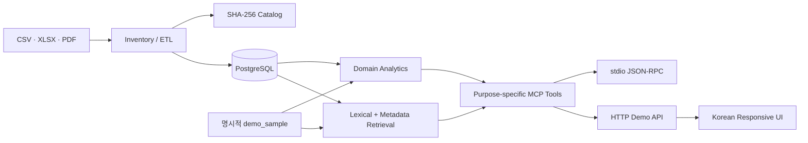

# 아키텍처

## 목표

정량 계산은 타입이 있는 도메인 함수/관계형 저장소가 담당하고, 문서 검색은 검색
모듈이 담당하며, MCP 계층은 둘을 안전한 목적별 도구로 노출한다. UI나 LLM이 임의
SQL을 만들지 않도록 하는 것이 핵심 경계다.

## 계층

### 수집·정규화

- `pipelines/src/catalog.ts`: 재귀 인벤토리, SHA-256, 날짜·미디어 형식·상태
- `pipelines/src/csv.ts`: UTF-8/CP949 판별, 헤더 기반 유형 감지, 인구·의안 정규화
- `pipelines/src/xlsx.ts`: 시트명을 고정하지 않고 인구 시트/행을 탐색
- 원본 경로는 NFC로 정규화해 기록하지만 원본 자체는 변경하지 않는다.

### 데이터

- `db/schema.sql`: 정량 fact, 정책·의회, 문서 chunk, source locator
- `data_source.data_status`는 `official_observed`, `demo_sample`, `catalog_only` 중 하나다.
- 해커톤 API 기본 저장소는 `data/sample/`을 메모리로 읽는다.

### 분석·검색

- `@gb/domain`: 추세 수학, 시군 비교, 정책 조건 설명, 근거 제한형 초안
- `@gb/retrieval`: NFC 정규화, 한글 단어/bi-gram, 부분 문자열, 메타데이터 필터
- `VectorSearchAdapter`는 향후 pgvector 또는 외부 임베딩 구현을 끼우는 경계다.
  기본값 `DisabledVectorAdapter`는 네트워크나 API 키 없이 결정적으로 동작한다.

### 전달

- stdio MCP는 공식 `@modelcontextprotocol/sdk`의 `Server`와
  `StdioServerTransport`를 사용한다.
- HTTP는 Node 내장 서버이며 MCP와 같은 registry/validation/실행 함수를 호출한다.
- 웹은 프레임워크 없는 HTML/CSS/JavaScript로 빌드 의존성을 최소화했다.

## 신뢰 경계

1. 모든 입력은 `.strict()` Zod 스키마를 통과한다.
2. 범용 SQL 도구를 제공하지 않는다.
3. 샘플이 하나라도 섞인 응답은 `data_status: demo_sample`이다.
4. 문서 초안은 `verified: true` 입력과 그 묶음 안의 source ID만 허용한다.
5. 수치 동시 변화는 관측으로 표현하고 원인으로 단정하지 않는다.

## 후속 확장

- PostgreSQL repository 구현과 ETL upsert
- `document_chunk`의 PDF 텍스트/OCR 적재
- `VectorSearchAdapter`의 pgvector 구현
- 실제 지방세·정책 공식 소스 adapter와 라이선스 검토
- 인증, rate limit, 감사 로그가 포함된 원격 MCP transport

