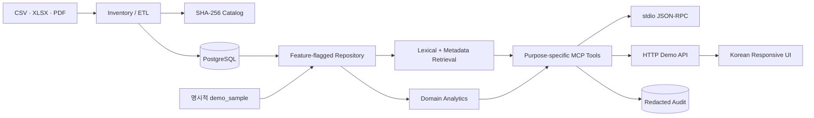

# 아키텍처

## 목표

정량 계산은 타입이 있는 도메인 함수/관계형 저장소가 담당하고, 문서 검색은 검색
모듈이 담당하며, MCP 계층은 둘을 안전한 목적별 도구로 노출한다. UI나 LLM이 임의
SQL을 만들지 않도록 하는 것이 핵심 경계다.

## 계층

### 수집·정규화

- `pipelines/src/catalog.ts`: 재귀 인벤토리, SHA-256, 날짜·미디어 형식·상태
- `pipelines/src/csv.ts`: UTF-8/CP949 판별, 헤더 기반 유형 감지, 인구·의안 정규화
- `pipelines/src/xlsx.ts`: 제목에서 기준 월을 찾고 canonical 경북/시군 행을 탐색
- `pipelines/src/regions.ts`: 경상북도와 현재 시·군 코드, alias, 지역 추론
- `pipelines/src/load-plan.ts`: 공식/데모 데이터를 결정적 source/fact/locator 계획으로 변환
- `pipelines/src/db.ts`: transaction, parameterized batch upsert, 실행 상태와 무결성 집계
- `pipelines/src/pdf.ts`: PDF.js 페이지 추출, 실패 분류, 문단/페이지 기반 overlap chunk
- `pipelines/src/embeddings.ts`: 로컬 feature-hash와 명시적 opt-in OpenAI provider
- `pipelines/src/pdf-db.ts`: document/chunk/embedding/locator의 재개 가능한 batch upsert
- 원본 경로는 NFC로 정규화해 기록하지만 원본 자체는 변경하지 않는다.

### 데이터

- `db/schema.sql`: 정량 fact, 정책·의회, 문서 chunk, source locator
- `data_source.data_status`는 `official_observed`, `demo_sample`, `catalog_only` 중 하나다.
- `pnpm db:normalize`은 ETL, 스키마/마이그레이션, 공식 데이터와 데모 전체 적재를 수행한다.
- source key와 의회 record ID는 원천 SHA/경로/행을 기반으로 결정적이며 행을 삭제하지 않는다.
- PDF의 현재 chunk는 `is_current`로 표시해 과거 행을 보존하면서 검색 오염을 막는다.
- `services/mcp-server/src/runtime.ts`는 `DATA_REPOSITORY=auto|postgres|memory|disabled`를
  해석한다. `auto`에서 `DATABASE_URL`이 있으면 PostgreSQL을 사용하며 DB 연결/필수
  schema가 실패하면 메모리로 조용히 fallback하지 않는다.

### 분석·검색

- `@gb/domain`: 추세 수학, 시군 비교, 정책 조건 설명, 근거 제한형 초안
- `@gb/retrieval`: 기존 in-memory 검색과 parameterized PostgreSQL hybrid repository
- `services/mcp-server/src/repository.ts`: 인구·지방세·정책·의회·문서·출처·주장 검증
  repository 계약과 메모리 구현
- `services/mcp-server/src/postgres-repository.ts`: 공식 우선 ranking, 명시적 상태 필터,
  bounded fact/document query, source/page context 구현
- PostgreSQL 경로는 FTS/trigram으로 bounded candidate를 만든 뒤 저장 `real[]` embedding을
  cosine rerank한다. 배열 전체 ANN scan은 하지 않는다.
- 기본 feature-hash는 lexical 신호이며 semantic provider가 아니다. OpenAI provider는
  `--allow-external` 없이는 생성할 수 없다.

### 전달

- stdio MCP는 공식 `@modelcontextprotocol/sdk`의 `Server`와
  `StdioServerTransport`를 사용한다.
- HTTP는 Node 내장 서버이며 MCP와 같은 registry/validation/실행 함수를 호출한다.
- `/health`는 프로세스 생존, 공개 `/ready`는 내부 mode/detail 없이 ready 여부만 돌려준다.
- HTTP와 stdio는 같은 repository를 주입하고 SIGINT/SIGTERM에서 pool을 닫는다.
- `http-security.ts`는 token digest 비교, correlation ID, trusted-proxy 정책, bounded
  token bucket, JSON shape 제한을 담당한다. stdio에는 적용하지 않는다.
- `/api/**`는 선택 token auth를 거치고 PDF hybrid/데모/초안 route는 더 낮은 rate
  budget과 별도 operation timeout을 사용한다.
- Node request/header timeout과 PostgreSQL statement/query timeout이 장시간 작업을
  bounded failure로 종료한다.
- 웹은 프레임워크 없는 HTML/CSS/JavaScript로 빌드 의존성을 최소화했다.

## 신뢰 경계

1. 모든 입력은 `.strict()` Zod 스키마를 통과한다.
2. 범용 SQL 도구를 제공하지 않는다.
3. DB CLI는 고정된 schema/load/normalize 명령만 제공하고 값은 parameter binding한다.
4. 문서 본문은 기본 provider에서 외부로 전송하지 않는다.
5. 외부 embedding은 provider 선택과 `--allow-external`을 모두 요구한다.
6. 상태 필터 기본값은 공식+데모이며 실제 반환 상태가 섞이면 `data_status: mixed`와
   `data_statuses`로 모호하지 않게 표시한다.
7. 문서 초안은 `verified: true` 입력과 그 묶음 안의 source ID만 허용한다.
8. 수치 동시 변화는 관측으로 표현하고 원인으로 단정하지 않는다.
9. 감사 로그는 raw query/secret 대신 process salt 기반 hash와 필드 타입/길이만 저장한다.
10. 감사 저장 실패는 경고하지만 read-only 도구 성공을 뒤집지 않는다.
11. token mode는 32바이트 이상 secret 없이는 시작하지 않고 digest를 constant-time 비교한다.
12. proxy header는 기본 불신이며 loopback/명시 IP proxy를 설정했을 때만 validated
    XFF를 사용한다.
13. route/method/tool allowlist, 64KiB body, JSON depth/node 제한과 same-origin CSP를 적용한다.
14. strict/generate된 request ID는 응답·안전 오류·audit correlation에 사용한다.

## 후속 확장

- `ocr_required` PDF의 승인된 OCR 처리
- corpus가 커질 때 모델별 pgvector partition/ANN index
- 실제 지방세·정책 공식 소스 adapter와 라이선스 검토
- 감사 로그 정기 purge job과 운영 경보
- multi-instance 공용 rate-limit store와 tenant별 token/권한
- reverse proxy TLS, secret rotation, WAF 정책의 배포 자동 검증
