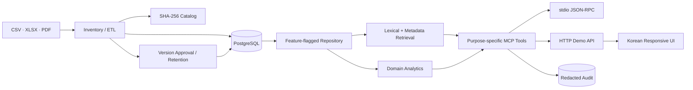

# 아키텍처

## 목표

정량 계산은 타입이 있는 도메인 함수/관계형 저장소가 담당하고, 문서 검색은 검색
모듈이 담당하며, MCP 계층은 둘을 안전한 목적별 도구로 노출한다. UI나 LLM이 임의
SQL을 만들지 않도록 하는 것이 핵심 경계다.

## 계층

### 수집·정규화

- `pipelines/src/catalog.ts`: 재귀 인벤토리, SHA-256, 날짜·미디어 형식·상태
- `pipelines/src/csv.ts`: UTF-8/CP949 판별, 헤더 기반 유형 감지, 인구·의안 정규화
- `pipelines/src/local-tax.ts`: 지방세 grain 판별, canonical 코드 검증, KRW 단위 변환,
  aggregate/detail reconciliation, 품질 issue·격리와 headline fact 선택
- `pipelines/src/local-tax-yearbook.ts`: HWPX 내부 장/표 marker 기반 행정안전부 연감
  판별, 시·군세/도세 scope 분리, 22개 지역 subtotal/detail reconciliation
- `pipelines/src/xlsx.ts`: 제목에서 기준 월을 찾고 canonical 경북/시군 행을 탐색
- `pipelines/src/regions.ts`: 경상북도와 현재 시·군 코드, alias, 지역 추론
- `pipelines/src/load-plan.ts`: 공식/데모 데이터를 결정적 source/fact/locator 계획으로 변환
- `pipelines/src/db.ts`: transaction, parameterized batch upsert, 실행 상태와 무결성 집계
- `pipelines/src/pdf.ts`: PDF.js layout 추출, page 품질 점수, 고신뢰 반복 margin 정리,
  발언자 turn/table-aware deterministic chunk, 도정 업무계획 유형/연도 evidence
- `pipelines/src/korean-text-quality.ts`: Unicode 범위만 믿지 않는 행정 용어·bigram·조사·
  syllable composition 기반 mojibake/unusable-text 분류
- `pipelines/src/pdf-quality.ts`: source/page SHA와 짧은 marker golden 평가, corpus 분포와 severe gate
- `pipelines/src/embeddings.ts`: 로컬 feature-hash와 명시적 opt-in OpenAI provider
- `pipelines/src/pdf-db.ts`: document/page/chunk/locator와 streaming embedding batch upsert
- `pipelines/src/lifecycle.ts`: processing version 승인/rollback, 용량 보고, plan-token purge,
  audit 집계와 allowlist maintenance
- `pipelines/src/lifecycle-cli.ts`: 임의 SQL 없는 고정 lifecycle 운영 명령
- 원본 경로는 NFC로 정규화해 기록하지만 원본 자체는 변경하지 않는다.

### 데이터

- `db/schema.sql`: 정량 fact, 정책·의회, 문서 chunk, source locator
- `data_source.data_status`는 `official_observed`, `demo_sample`, `catalog_only` 중 하나다.
- `pnpm db:normalize`은 ETL, 스키마/마이그레이션과 공식 데이터만 적재한다.
- source key는 원천 경로와 SHA를 기반으로 결정적이다. 일반 의회 CSV record ID는
  원천 SHA/경로/행을 사용하고, 포항 공개 의안은 직렬화 변경에도 안정적인 원문
  레코드 ID를 사용한다. 기존 ID 교체는 동일 원문 레코드가 새 계획에도 있을 때만
  트랜잭션 안에서 수행한다.
- 지방세는 징수, 납부매체, 과세, 1인당 부담, 납세자, 비과세·감면, 미환급,
  번호판 영치를 호환되지 않는 별도 grain으로 저장한다.
- `local_tax_revenue`는 도구용 headline fact이며 원본 의미를
  `amount_semantics`, `source_grain`, 원단위/배수/판정근거, aggregate 여부로 보존한다.
- address-level property valuation은 catalog governance만 저장하고 fact/search/embedding에
  넣지 않는다. 영치 장소 문자열도 저장하지 않는다.
- 인구 fact는 `measurement_basis`와 `reference_date_precision`을 보존한다.
  과세연도 보고 인구, 주민등록 snapshot, 연간 통계를 서로 바꿔 쓰지 않으며
  동질 series가 아닐 때 파생 추세를 만들지 않는다.
- PDF page는 raw/cleaned hash와 품질 지표를 가지며 현재 extractor 결과만 `is_current`다.
- page/document는 `extracted_ok`, `mojibake_suspected`,
  `unusable_for_retrieval`, `empty`와 `native_pdf_text`, `none` extraction method를
  별도로 저장한다.
- 제외 page는 raw hash/품질/제외 이유는 보존하지만 cleaned text를
  chunk/embedding/search에 전달하지 않는다.
- PDF 처리 version은 `candidate`, `approved`, `retired` lifecycle을 가지며 partial unique
  index로 approved version 하나만 허용한다.
- 검색 가능한 chunk는 `is_current AND approved_current`이고 해당
  `pdf_processing_version.approval_state = 'approved'`여야 한다.
- 새 처리 version 적재는 candidate로 보존되며 명시적 승인 전 기존 production 검색을
  바꾸지 않는다. retained version rollback은 embedding 재계산 없이 transaction으로
  chunk/page/document 가시성을 전환한다. 과거 version에 없던 후발 문서는 rollback
  동안 숨겨지므로 운영자가 coverage 차이를 승인해야 한다.
- `services/mcp-server/src/runtime.ts`는 `DATA_REPOSITORY=auto|postgres|memory|disabled`를
  해석한다. `auto`에서 `DATABASE_URL`이 있으면 PostgreSQL을 사용하며 DB 연결/필수
  schema가 실패하면 메모리로 조용히 fallback하지 않는다.

### 분석·검색

- `@gb/domain`: 추세 수학, 시군 비교, 정책 조건 설명, 근거 제한형 초안
- trend derivation은 status와 metric semantics/basis/grain/unit을 포함한 compatibility
  key가 전체 point에서 같고 point가 두 개 이상일 때만 허용한다.
- `@gb/retrieval`: 기존 in-memory 검색과 parameterized PostgreSQL hybrid repository
- `services/mcp-server/src/repository.ts`: 인구·지방세·정책·의회·문서·출처·주장 검증
  repository 계약과 메모리 구현
- `services/mcp-server/src/postgres-repository.ts`: 공식 우선 ranking, 명시적 상태 필터,
  bounded fact/document query, source/page context 구현
- 지방세 ranking은 같은 지역·연도·세목에서 공식 자료를 먼저 고르고, 공식 grain끼리는
  동일 범위 지자체 징수 수납액, 연감 시·군세 소계, 1인당 부담 총액, 납부액 순으로
  선택한다. `headlineEligible=false`인 도세+시·군세 결합 합계는 도구에서 제외한다.
  회계 기준이 다르다는 이유로 공식과 샘플을 중복 반환하지 않는다.
- PostgreSQL 경로는 FTS/trigram으로 bounded candidate를 만든 뒤 저장 `real[]` embedding을
  cosine rerank한다. 배열 전체 ANN scan은 하지 않는다.
- source context는 current page/chunk locator만 노출해 과거 chunker 결과가 섞이지 않는다.
- `search_policies`는 공식 `policy_program`과 `provincial_work_plan` page passage를
  출처와 함께 반환한다. 공식 prose에서 확인되지 않은 자격 필드를 추론하지 않는다.
- stale purge는 최소 보존기간, advisory lock, 정확한 candidate-set hash, bounded
  FK-safe batch를 요구하며 approved/current/provenance를 보호한다.
- 기본 feature-hash는 lexical 신호이며 semantic provider가 아니다. OpenAI provider는
  `--allow-external` 없이는 생성할 수 없다.

### 전달

- stdio MCP는 공식 `@modelcontextprotocol/sdk`의 `Server`와
  `StdioServerTransport`를 사용한다.
- HTTP는 Node 내장 서버이며 MCP와 같은 registry/validation/실행 함수를 호출한다.
- `/health`는 프로세스 생존, 공개 `/ready`는 내부 mode/detail 없이 ready 여부만 돌려준다.
- token 전용 `/api/admin/storage`만 current/stale 용량, lifecycle version과
  shared-memory 관련 PostgreSQL 설정을 반환한다.
- HTTP와 stdio는 같은 repository를 주입하고 SIGINT/SIGTERM에서 pool을 닫는다.
- `http-security.ts`는 token digest 비교, correlation ID, trusted-proxy 정책, bounded
  token bucket, JSON shape 제한을 담당한다. stdio에는 적용하지 않는다.
- `/api/**`는 선택 token auth를 거치고 PDF hybrid/데모/초안 route는 더 낮은 rate
  budget과 별도 operation timeout을 사용한다.
- Node request/header timeout과 PostgreSQL statement/query timeout이 장시간 작업을
  bounded failure로 종료한다.
- 웹은 프레임워크 없는 HTML/CSS/JavaScript로 빌드 의존성을 최소화했다.

## 신뢰 경계

1. 모든 입력은 `.strict()` Zod 스키마를 통과한다.
2. 범용 SQL 도구를 제공하지 않는다.
3. DB CLI는 고정된 schema/load/normalize 명령만 제공하고 값은 parameter binding한다.
4. 문서 본문은 기본 provider에서 외부로 전송하지 않는다.
5. 외부 embedding은 provider 선택과 `--allow-external`을 모두 요구한다.
6. 상태 필터 기본값은 공식+데모이며 실제 반환 상태가 섞이면 `data_status: mixed`와
   `data_statuses`로 표시하되 혼합 point의 summary/verdict는 NULL이다.
7. 문서 초안은 `verified: true`, 묶음 안의 source ID, demo가 아닌 공식 source만 허용한다.
8. 수치 동시 변화는 관측으로 표현하고 원인으로 단정하지 않는다.
9. 감사 로그는 raw query/secret 대신 process salt 기반 hash와 필드 타입/길이만 저장한다.
10. 감사 저장 실패는 경고하지만 read-only 도구 성공을 뒤집지 않는다.
11. token mode는 32바이트 이상 secret 없이는 시작하지 않고 digest를 constant-time 비교한다.
12. proxy header는 기본 불신이며 loopback/명시 IP proxy를 설정했을 때만 validated
    XFF를 사용한다.
13. route/method/tool allowlist, 64KiB body, JSON depth/node 제한과 same-origin CSP를 적용한다.
14. strict/generate된 request ID는 응답·안전 오류·audit correlation에 사용한다.
15. production PDF 검색은 단일 approved processing version만 사용한다.
16. stale/audit 삭제는 dry-run이 기본이며 exact plan token, 최소 보존기간, allowlist,
    advisory lock과 bounded 실행 한도를 모두 통과해야 한다.
17. purge transaction에서 VACUUM을 실행하거나 `53100` VACUUM을 자동 재시도하지 않는다.
18. 지방세 금액의 blank는 0으로 만들지 않고 NULL 또는 row quarantine으로 남기며,
    aggregate와 detail을 중복 합산하지 않는다.
19. 무표기 천원 판정은 명시적 천원 source와 3개 이상 exact category reconciliation이
    있어야 하며 filename 추정은 금지한다.
20. 검증되지 않은 영천 열 교환은 자동 수정하지 않고 quality issue로 격리한다.
21. demo 값은 claim을 지지·반박하지 않고, 비교 verdict는 양쪽 공식 homogeneous
    series와 exact endpoint가 있어야 한다.
22. 한글 codepoint 비율만으로 PDF text를 승인하지 않으며
    mojibake/unusable/empty page는
    검색 content를 만들 수 없다.
23. 공식 업무계획 passage는 page citation 문맥일 뿐 demo 정책의 자격 verdict를
    공식화하지 않는다.

## 후속 확장

- 제외된 2020·2022·2024 업무계획의 source replacement 또는 별도 OCR 타당성 결정
- 지역/연도/서식이 더 다양한 golden PDF와 실제 반복 footer 표본 확충
- 승인된 scheduler/backup 정책과 operator-run stale purge/VACUUM window
- corpus가 커질 때 모델별 pgvector partition/ANN index
- 2024년 외 연도의 22개 시·군 동일 scope 공식 headline과 completeness 확충
- 영천 비과세·감면 열 의미의 제공기관 확인 후 quarantine 해제 여부 결정
- lifecycle/audit purge의 외부 scheduler와 경보 전달 채널
- multi-instance 공용 rate-limit store와 tenant별 token/권한
- reverse proxy TLS, secret rotation, WAF 정책의 배포 자동 검증
